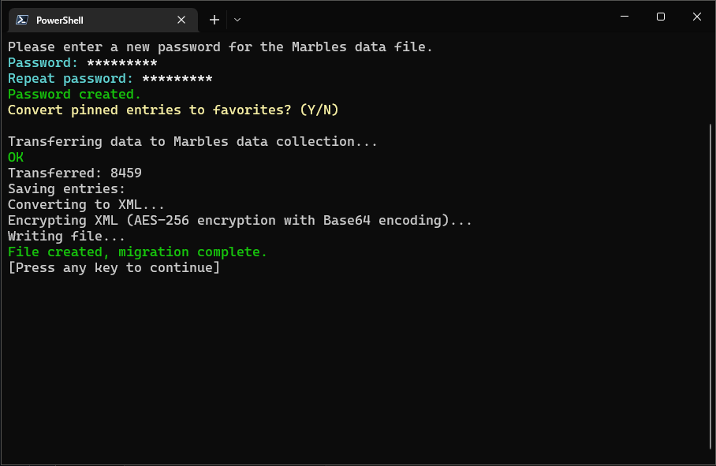

# Installing and running Marbles
Marbles is distributed as a framework-dependent application and does not include the .NET runtime. This means that .NET (a free open source cross-platform framework) must be installed on your system before you can run Marbles.

## Install .NET
Ensure that you have the .NET 10 runtime installed on your system. If not you can get it here:

- [Install .NET on Windows](https://learn.microsoft.com/en-us/dotnet/core/install/windows)
- [Install .NET on Linux](https://learn.microsoft.com/en-us/dotnet/core/install/linux)
- [Install .NET on macOS](https://learn.microsoft.com/en-us/dotnet/core/install/macos)
- [Download the .NET Runtime 10.0](https://dotnet.microsoft.com/en-us/download/dotnet/10.0)

## Download and run Marbles

   1. Download the latest Marbles zip file from the [releases page](https://github.com/artstisen/marbles/releases).
   2. Unzip _Marbles.dll_ and _Marbles.runtimeconfig.json_ into a directory of your choosing.
   3. Open your favorite terminal, navigate to the Marbles directory and type ```dotnet Marbles.dll``` (Linux and macOS are case sensitive)

You can create an alias like "_mbls_" to run Marbles with less typing. See [this guide](Guide-to-windows-terminal-crt.md) for more information.

Marbles keeps your notes and settings in a directory named "data", created in the directory you start Marbles from. To use spell checking in the editor, place spell files in a directory named "spell" next to it (see the [guide to the editor](Guide-to-editor.md#spell-checking)). Marbles needs a terminal window of at least 80 columns and 23 rows.

## Building from source
With the .NET 10 SDK installed:

```
dotnet build Marbles.sln -c Release
```

The files to run are then found in _Marbles/bin/Release/net10.0_.

To build executables that include the .NET runtime (so nothing has to be installed to run them), run ```./publish.ps1``` with PowerShell. It creates a single file for each platform in the directory _publish_. On Linux and macOS the file must be made executable before it is run: ```chmod +x Marbles```.

## Upgrading from Marbles v1.0.x
Copy your "data" directory to the directory of the new version, or unzip the new version over the old.
The first time you log in to a data file it is converted to the new file format, which earlier versions cannot open. Please read the [list of changes](CHANGELOG.md) before upgrading.

# Migrating your notes from AHOY! to Marbles

If you are using the [Ahoy note-taking application](https://github.com/artstisen/AHOY) you can migrate your data to Marbles using the AhoyToMarbles migration tool. The tool creates a data file in the format of Marbles v1.0.x, which Marbles converts the first time you log in to it.



### Specifications:

- Supported platforms: Windows and Linux
- Requirements: .NET 6
- Software license: MIT
- Download: [AhoyToMarbles1012.zip](https://github.com/artstisen/marbles/releases/download/v1.0.1.1/AhoyToMarbles1012.zip) (18Kb)
- Download w. Conhost executable (Windows): [AhoyToMarbles1012-WinExe.zip](https://github.com/artstisen/marbles/releases/download/v1.0.1.1/AhoyToMarbles1012-WinExe.zip) (90Kb)
