# Marbles
A free, open-source, cross-platform program for keeping encrypted notes, with a Vim-style editor, in any terminal on Windows, Linux and macOS.

All your notes are kept in a single encrypted file that is easy to back up and carry along. You find them with search, favorites and pinned notes, and write them with the keys of Vim.

> **Looking for a text editor?** If you want a versatile modal editor to plan, organize and write Typst, Markdown and code directly in your terminal, take a look at my other project, Blyant: [github.com/artstisen/blyant](https://github.com/artstisen/blyant) and [blyant-editor.com](https://blyant-editor.com).

| | |
|---|---|
| 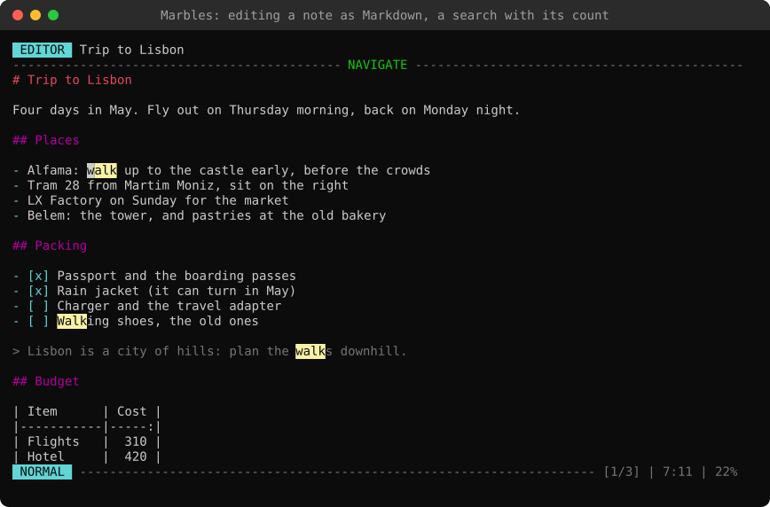 | 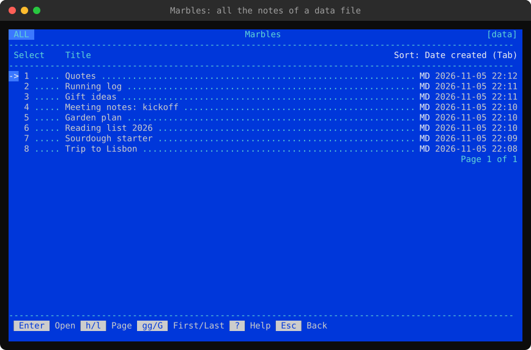 |
| 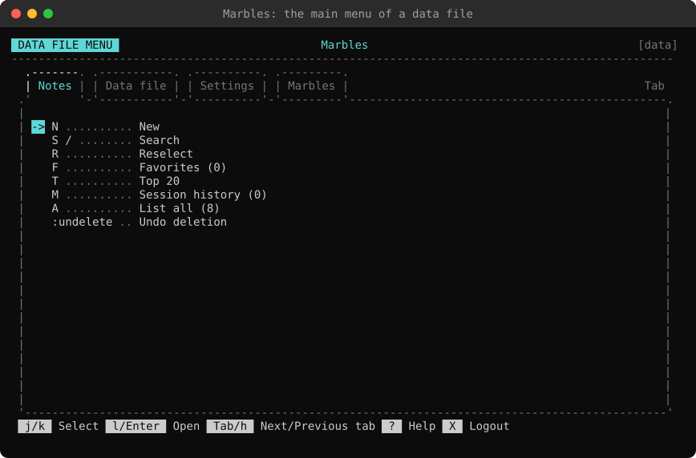 | 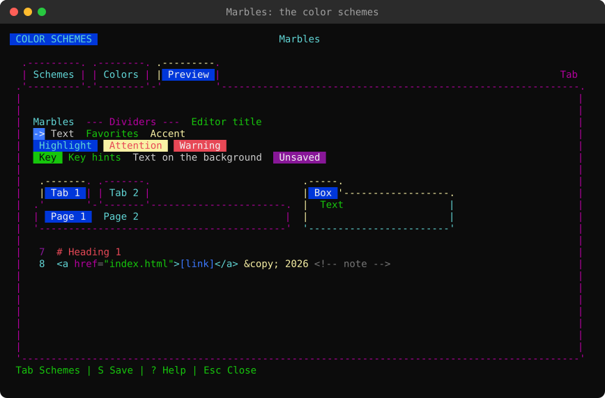 |

The screenshots are of the real program, made with [tools/screenshots.py](tools/screenshots.py) from a data file of made-up notes, in the color schemes Default, Deep Blue and Tasty Bytes.

## Key features

**Encrypted notes**
- All your notes in a single data file, encrypted with AES-256-GCM and your password
- Search, favorites, pinned notes, session history and read-only notes
- A backup copy in a directory of your choice each time the data file is saved
- Several data files, which can be created, merged and exported from within Marbles
- Handles large notes and data files with thousands of notes

**Written with the keys of Vim**
- Normal, Insert and Visual modes (also block selection), counts, text objects, registers and undo
- Spell checking, word completion, and search and replace with regular expressions
- Split view, syntax highlighting (Markdown and code), snippets and macros
- The same keys everywhere: `h` `j` `k` `l` to move, `/` to search, `?` for help and `:` for commands

**At home in any terminal**
- Pure 7-bit ASCII interface that works with any monospaced font
- Color schemes and logos, which you can edit and make your own
- English built in, and ten more languages as files that can be changed or added to
- Runs on Windows, Linux (also Raspberry Pi) and macOS, as a single file with nothing else to install

**Also for files**
- A file browser with two panes for ordinary text files, edited with the same editor, and for managing files and directories
- The Jump menu (`Ctrl+O`) goes to bookmarks, recent places, files and data files in a few keys

## Getting started
1. Download the build for your platform from the [releases page](https://github.com/artstisen/marbles/releases), and unzip it into a directory of your choice.
2. Start `Marbles` (or `Marbles.exe` on Windows) in your terminal.
3. Marbles starts in **Note Management**, at the login page of your data file. The first time, you create the password of your data file. Keep it safe: your notes cannot be recovered without it.
4. Press `?` on any page to see its keys, or open the Quick guide from the start page.

See the [guide to installation](Guide-to-installation.md) for the builds and the details.

## About Marbles
Marbles provides a simple interface for creating, editing, searching, arranging, importing, exporting and deleting notes. Notes are stored as a searchable collection of entries in a single encrypted file for easy portability, and several data files can be created and managed from within the program itself.

The aim is an unbloated set of core tools: I've included the functionality I would normally have added via lightweight plugins and init modifications in Neovim, without disrupting the classic terminal aesthetic. The interface is drawn with standard 128-character ASCII only (no extended ASCII or ANSI character sets), so it works with all standard monospaced fonts on every platform. The notes themselves can contain any Unicode text.

## Gallery

Marbles v1.5.3 in Windows Terminal on Windows 11:

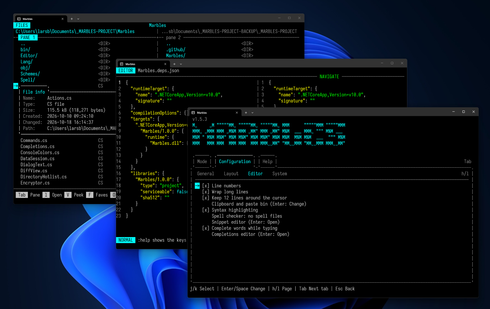

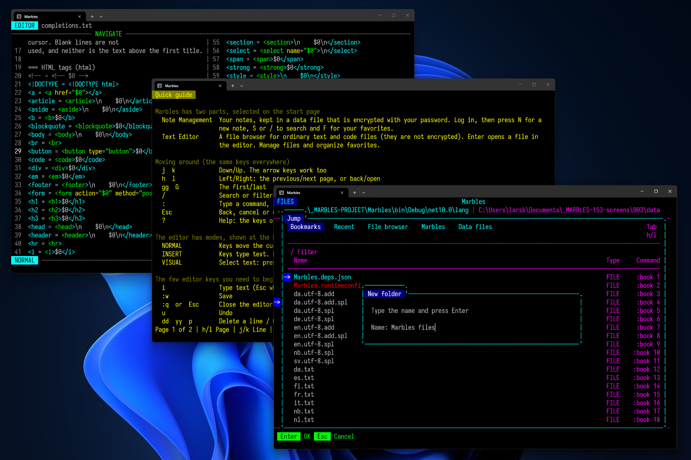

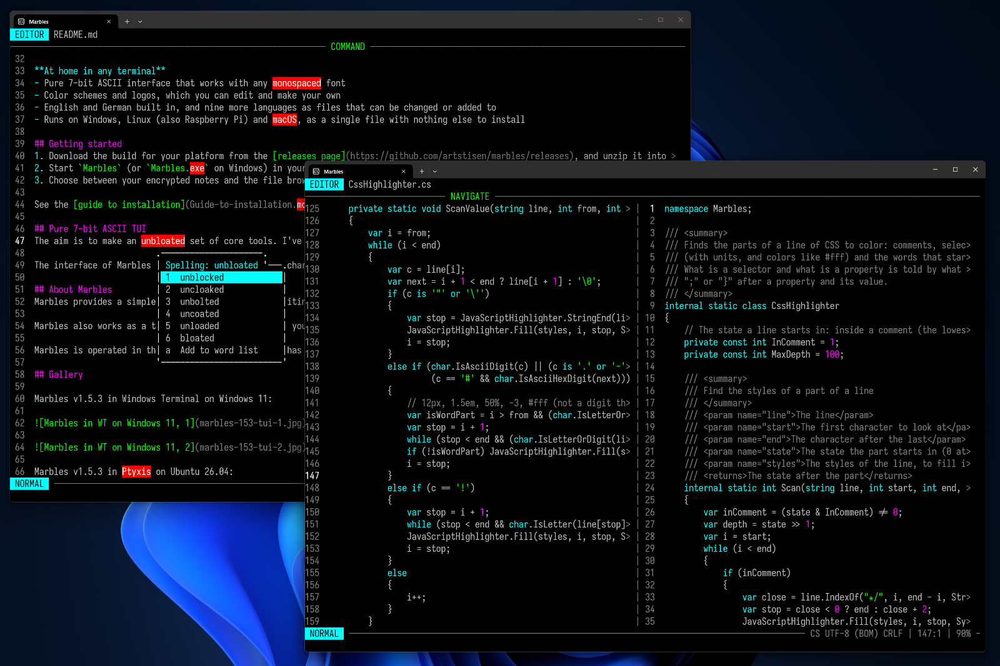

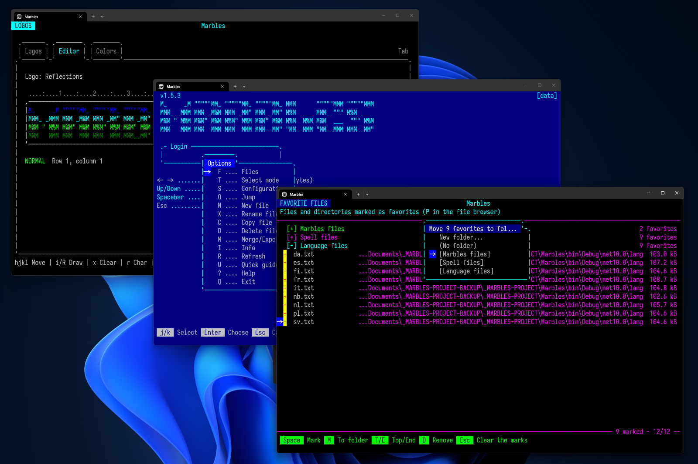

Marbles v1.5.3 in Ptyxis on Ubuntu 26.04:

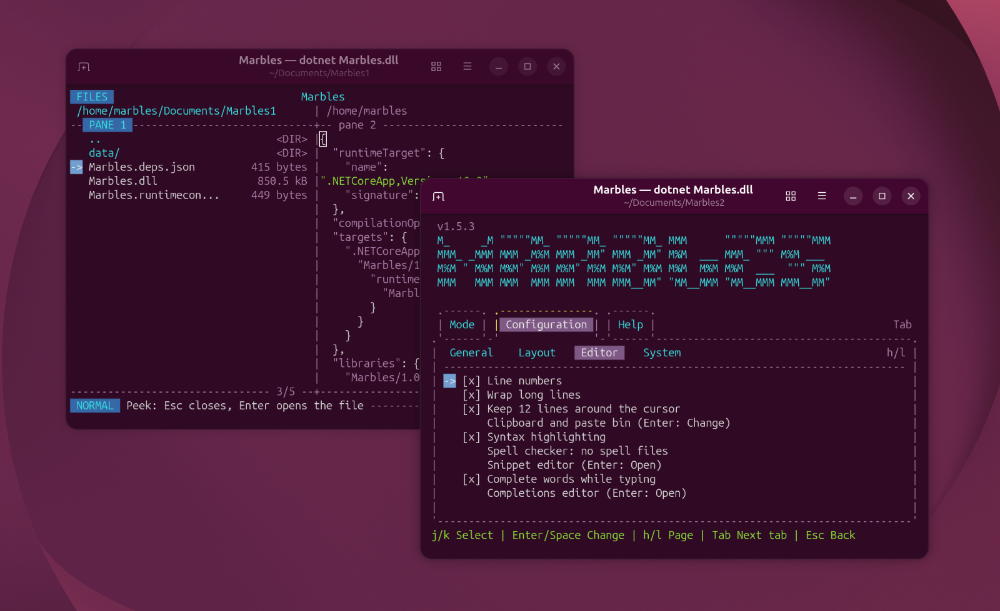

Marbles v1.5.3 in LXTerminal on Raspberry Pi OS:

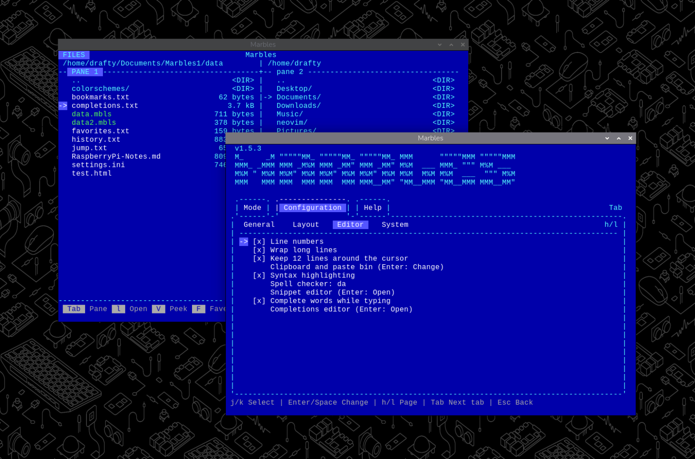

Marbles v1.0.1 in Windows Terminal with the CRT mod:

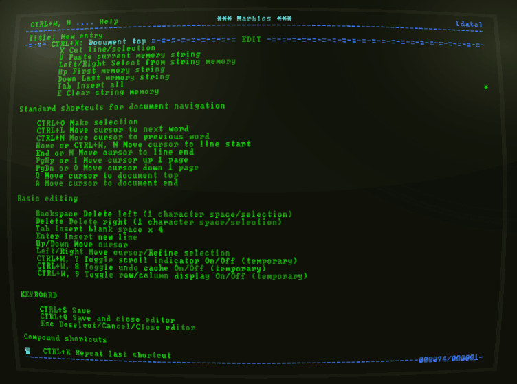

Multiple instances of Marbles v1.0.1 in a split Windows Terminal with the CRT mod:

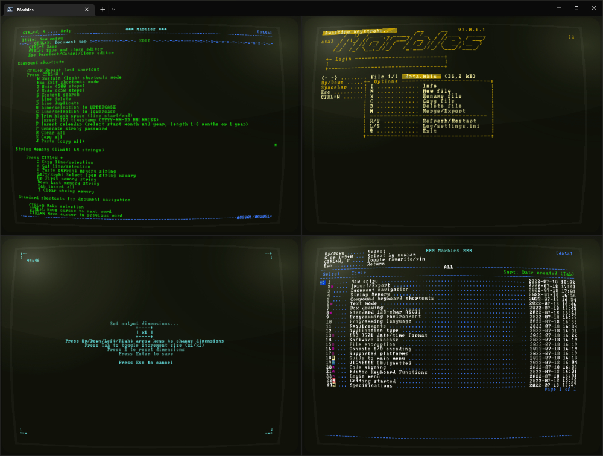

## Guides
- [Download and installation](Guide-to-installation.md)
- [Start page, login and file browser](Guide-to-login-menu.md)
- [Main menu, lists and entries](Guide-to-main-menu.md)
- [Editor](Guide-to-editor.md)
- [PowerShell alias and the Windows Terminal CRT mod](Guide-to-windows-terminal-crt.md)
- [Changes and upgrading from earlier versions](CHANGELOG.md)

Inside Marbles, press `?` for the list of keys.

## Specifications
| | |
|---|---|
| Supported platforms | Windows, Linux and macOS |
| Requirements | None for the single-file builds (the .NET runtime is included); the portable build needs the .NET 10 runtime |
| Application type | Text mode |
| Core code base | Agnostic: no OS-specific logic, .NET handles the differences between the platforms |
| Box drawing | Classic ASCII |
| Console I/O encoding | UTF-8 |
| Languages | English built in; Danish, German, Norwegian (bokmål), Swedish, Spanish, French, Italian, Polish, Dutch and Finnish as language files that can be changed, and more can be added (the commands and keys are the same in all languages). The language files are also a pack of their own on the releases page (`Marbles-languages-1.5.4.zip`) |
| Date/time format | ISO 8601 |
| File encryption | AES-256-GCM, with the key derived from the password using PBKDF2-HMAC-SHA256 |
| Software license | [MIT](LICENSE) |

## Building from source
Marbles has no dependencies besides .NET itself.

```
dotnet build Marbles.sln
dotnet test Marbles.sln
dotnet run --project Marbles
```

`publish.ps1` builds self-contained single file executables (with the .NET runtime included) for Windows, Linux and macOS, and the lightweight version for all platforms that needs the .NET runtime.

`AGENTS.md` has the rules for working on the code (for people and for coding agents).

## Tools used
- Written in C#, a single binary file, no dependencies, runs in the terminal you already use
- CLI tools: JetBrains Command Line Tools, .NET CLI compiler, PowerShell, and GitHub CLI
- Agentic tools: Claude Opus 5.5 (scripting/testing/code review)
- Code editor: Blyant with syntax highlighting, code completion, and code snippets
- Programming language: C# 14
- Framework: .NET 10
