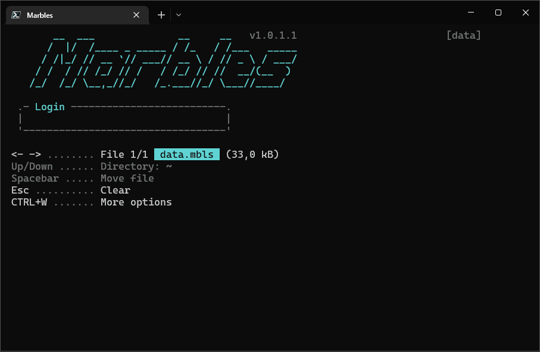
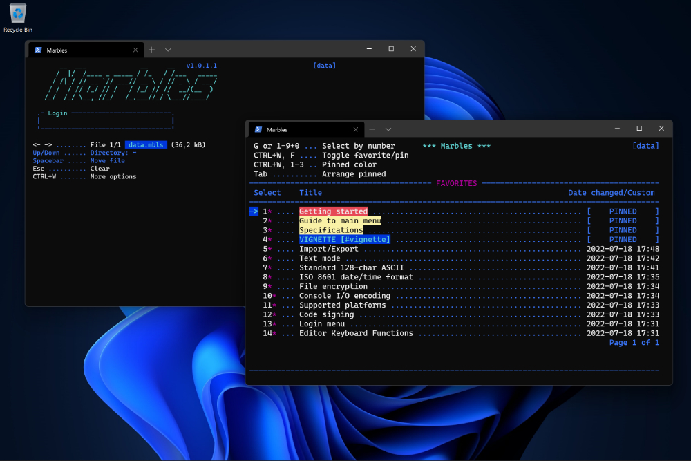
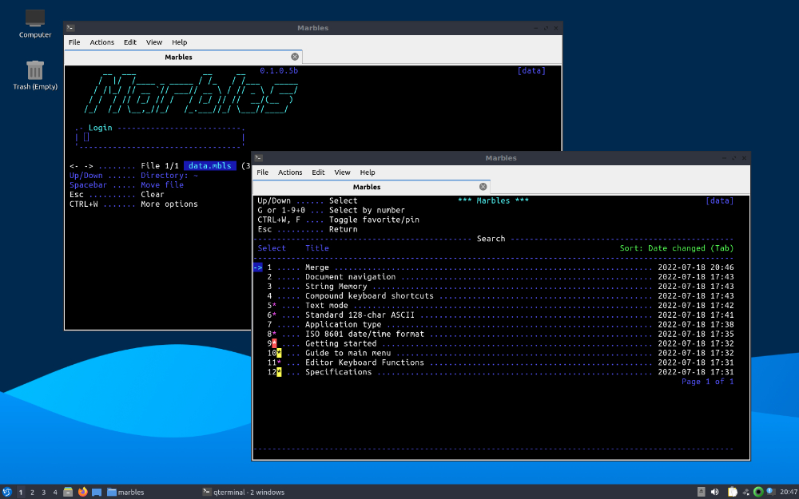
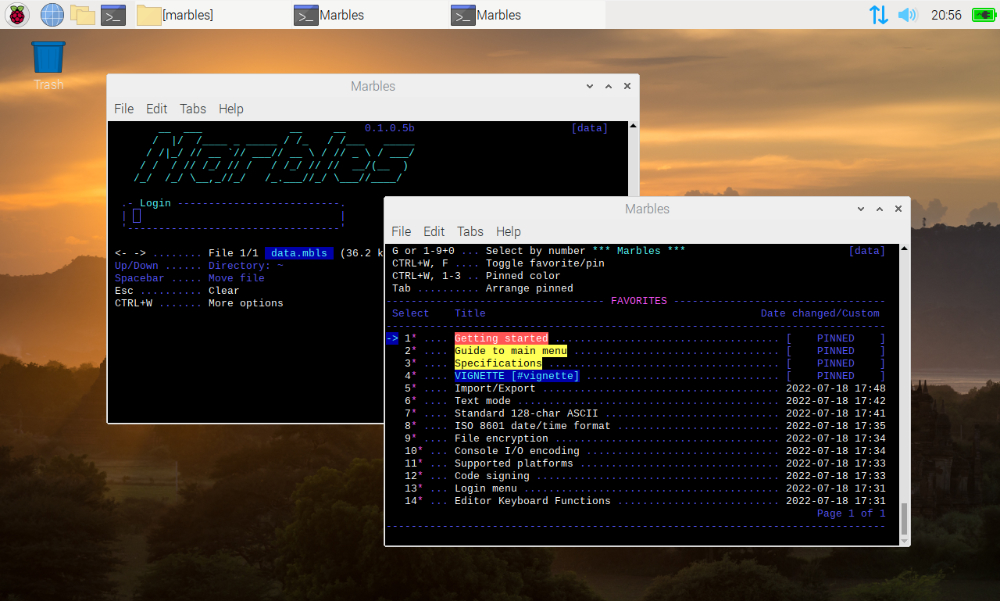
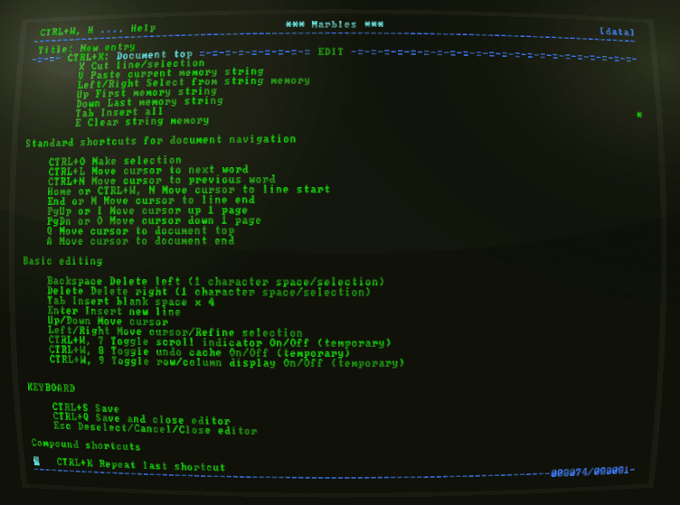
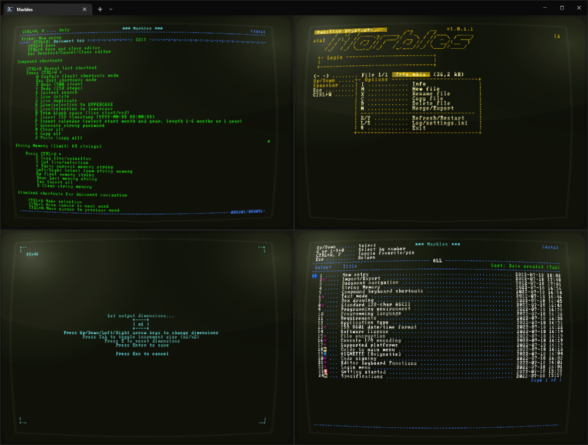

# Marbles
A lightweight cross-platform text mode application for taking notes with encryption in any terminal application on Windows, Linux and macOS.




## About Marbles
Marbles provides a simple interface for creating, editing, searching, copying, arranging, importing, exporting and deleting notes. Notes are stored as a searchable collection of entries contained in a single encrypted file for easy portability. Multiple files can be created and managed from within the program itself. Marbles will handle large text documents and data files with thousands of notes.

Marbles also works as a text editor: when it starts you select between your encrypted notes and a file browser for editing ordinary text files (.txt, .md, .html ...) with the same editor. It can be set to start directly in either.

Marbles is operated in the style of Vim: the editor has Normal, Insert and Visual modes, and the menus and lists use the same keys for moving around (`h` `j` `k` `l`), searching (`/`), help (`?`) and commands (`:`).

> Check out my latest project: **Easy file encryption for Neovim** [https://github.com/artstisen/marbles.nvim](https://github.com/artstisen/marbles.nvim)

## Specifications
- Supported platforms: Windows, Linux and macOS
- Requirements: .NET 10 runtime
- Application type: Text mode
- Box drawing: ASCII
- Console I/O encoding: UTF-8
- Date/time format: ISO 8601
- File encryption: AES-256-GCM, with the key derived from the password using PBKDF2-HMAC-SHA256
- Software license: MIT

## Tools used
- Programming language: C# 14
- Framework: .NET 10

The interface of Marbles is drawn with standard 128-character ASCII only (no extended ASCII or ANSI character sets). This makes Marbles compatible with all standard monospaced fonts, regardless of the platform. Your notes can contain any Unicode text.

Marbles relies on the .NET framework to handle the differences between the platforms and has no OS-specific logic built into the source.

## Guides/getting started
- [Download and installation](Guide-to-installation.md)
- [Login page](Guide-to-login-menu.md)
- [Main menu, lists and entries](Guide-to-main-menu.md)
- [Editor](Guide-to-editor.md)
- [Changes and upgrading from earlier versions](CHANGELOG.md)
- [PowerShell scripting tips](Guide-to-windows-terminal-crt.md)

Inside Marbles, press `?` for the list of keys.

## Building from source
Marbles has no dependencies besides .NET itself.

```
dotnet build Marbles.sln
dotnet test Marbles.sln
dotnet run --project Marbles
```

`publish.ps1` builds self-contained single file executables (with the .NET runtime included) for Windows, Linux and macOS, and the lightweight version for all platforms that needs the .NET runtime.

## Gallery

Marbles in Windows Terminal on Windows 11:


Marbles in QTerminal on Lubuntu (lightweight Linux distribution based on Ubuntu):


Marbles in LXTerminal on Raspberry Pi (Debian-based Linux distribution):


Marbles in Windows Terminal with CRT mod:


Multiple instances of Marbles in split Windows Terminal with CRT mod:


### Windows Terminal CRT mod:

- [Guide to installing the Windows Terminal CRT mod](Guide-to-windows-terminal-crt.md)
