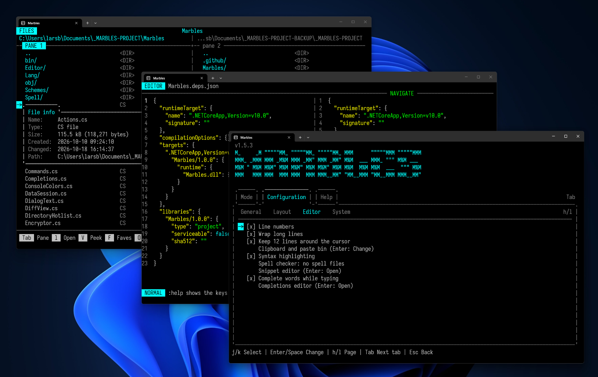
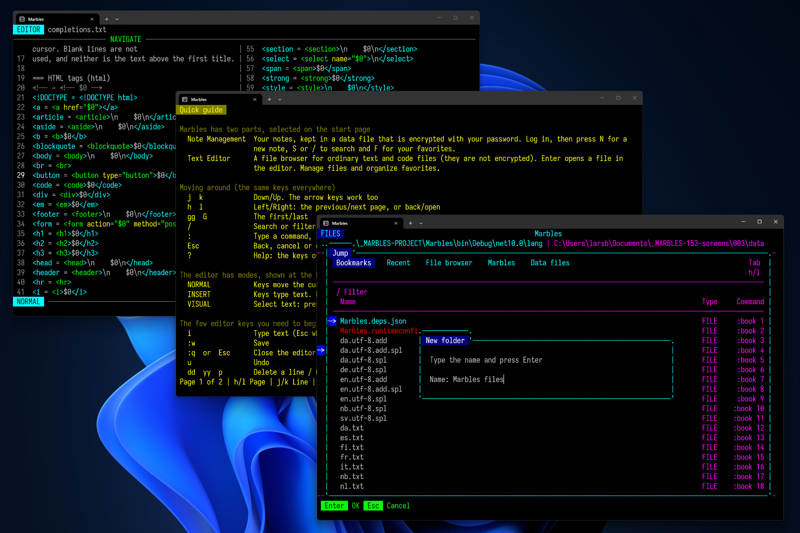
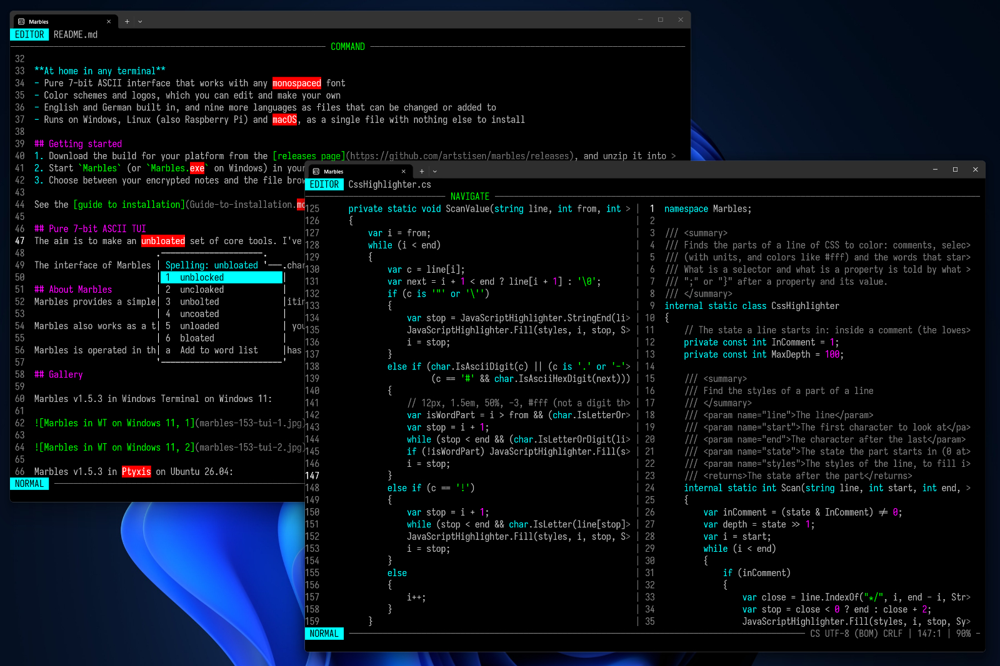
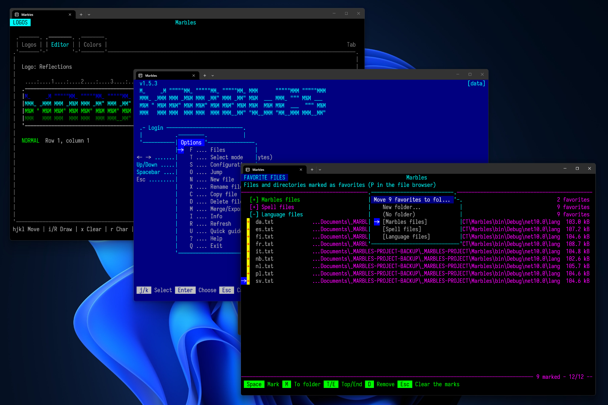
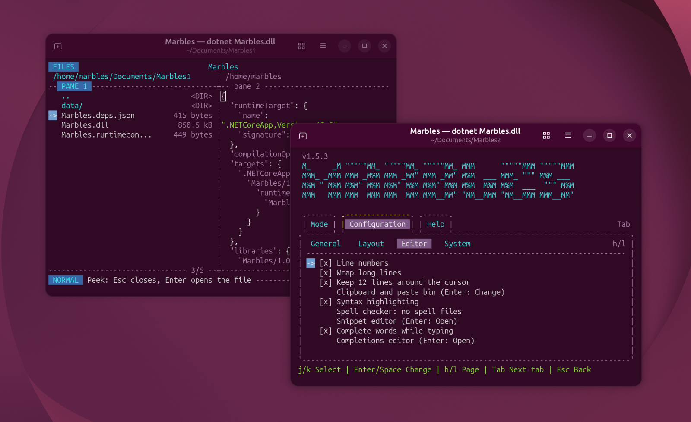
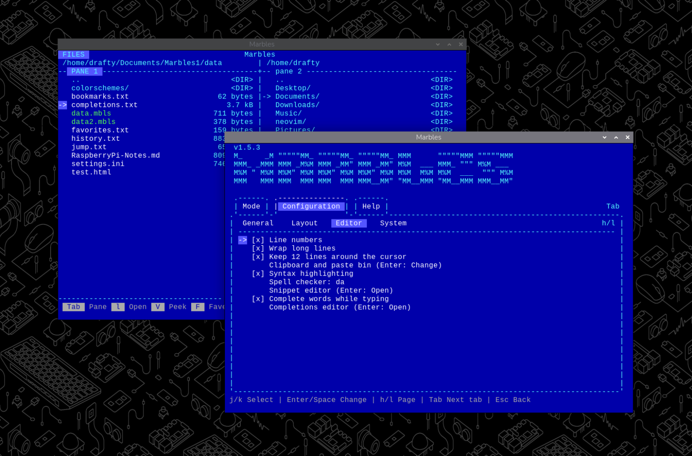

# Marbles
A free, open-source, cross-platform, Vim-style modal text editor for taking encrypted notes in any terminal program on Windows, Linux and macOS.

Marbles is also a capable Unicode text editor and an orthodox file manager, so the same tool and the same keys work for your private notes, your text and code files, and your directories.



## Key features

**Encrypted notes**
- All your notes in a single encrypted data file (AES-256-GCM), easy to back up and carry along
- Search, favorites, pinned notes, session history and read-only notes
- Several data files, which can be created, merged, exported and managed from within Marbles
- Handles large documents and data files with thousands of notes

**A Vim-style editor**
- Normal, Insert and Visual modes (also block selection), counts, text objects, registers and undo
- Split view: the same text in two panes side by side, remembered when you open it again
- Syntax highlighting (Markdown, HTML, PHP, CSS, JavaScript, C#, JSON, XML), spell checking and word completion
- Search and replace with regular expressions, file comparison (diff), code snippets, and a macro recorder whose macros can be edited as text
- A command line with `Tab` completion and command history on every page

**A file manager**
- An orthodox file browser with two panes: create, rename, copy, move, delete and compare
- Favorites (with folders and colors), file history, a directory hotlist and file search by name or text
- Peek at a file without opening it, and open any file at the place you left it

**Quick to get around**
- The Jump menu (`Ctrl+O`): bookmarks, recent places, files, pages and data files in a few keys
- The same keys everywhere: `h` `j` `k` `l` to move, `/` to search, `?` for help and `:` for commands
- Built-in guides: a quick guide and short guides to each part of Marbles

**At home in any terminal**
- Pure 7-bit ASCII interface that works with any monospaced font
- Color schemes and logos, which you can edit and make your own
- English and German built in, and nine more languages as files that can be changed or added to
- Runs on Windows, Linux (also Raspberry Pi) and macOS, as a single file with nothing else to install

## Getting started
1. Download the build for your platform from the [releases page](https://github.com/artstisen/marbles/releases), and unzip it into a directory of your choice.
2. Start `Marbles` (or `Marbles.exe` on Windows) in your terminal. `marbles .` opens the file browser in the directory you are in.
3. Choose between your encrypted notes and the file browser. Press `?` on any page to see its keys, or open the Quick guide from the start page.

See the [guide to installation](Guide-to-installation.md) for the builds and the details.

## Pure 7-bit ASCII TUI
The aim is to make an unbloated set of core tools. I've included functionality that I would normally have added via lightweight, functional plugins and init modifications in Neovim, without disrupting the classic terminal aesthetic.

The interface of Marbles is drawn with standard 128-character ASCII only (no extended ASCII or ANSI character sets). This makes Marbles compatible with all standard monospaced fonts, regardless of the platform. Encrypted notes and text/code files can contain any Unicode text.

## About Marbles
Marbles provides a simple interface for creating, editing, searching, copying, arranging, importing, exporting and deleting notes. Notes are stored as a searchable collection of entries in a single encrypted file for easy portability. Multiple data files can be created and managed from within the program itself.

Marbles also works as a text editor: when it starts, you choose between your encrypted notes and a file browser for editing ordinary text and code files (.txt, .md, .html, .json, .cs ...) with the same editor. It can be set to start directly in either. The file browser can also manage files and directories, and keeps your favorite files, the file history and a directory hotlist.

Marbles is operated in the style of Vim: the editor has Normal, Insert and Visual modes, and the menus and lists use the same keys for moving around (`h` `j` `k` `l`), searching (`/`), help (`?`) and commands (`:`).

## Gallery

Marbles v1.5.3 in Windows Terminal on Windows 11:







Marbles v1.5.3 in Ptyxis on Ubuntu 26.04:



Marbles v1.5.3 in LXTerminal on Raspberry Pi OS:



Marbles v1.0.1 in Windows Terminal with the CRT mod:


Multiple instances of Marbles v1.0.1 in a split Windows Terminal with the CRT mod:


See the [guide to installing the Windows Terminal CRT mod](Guide-to-windows-terminal-crt.md).

## Guides
- [Download and installation](Guide-to-installation.md)
- [Login page](Guide-to-login-menu.md)
- [Main menu, lists and entries](Guide-to-main-menu.md)
- [Editor](Guide-to-editor.md)
- [Changes and upgrading from earlier versions](CHANGELOG.md)
- [PowerShell scripting tips](Guide-to-windows-terminal-crt.md)

Inside Marbles, press `?` for the list of keys.

## Specifications
| | |
|---|---|
| Supported platforms | Windows, Linux and macOS |
| Requirements | None for the single-file builds (the .NET runtime is included); the portable build needs the .NET 10 runtime |
| Application type | Text mode |
| Core code base | Agnostic: no OS-specific logic, .NET handles the differences between the platforms |
| Box drawing | Classic ASCII |
| Console I/O encoding | UTF-8 |
| Languages | English and German built in; Danish, Norwegian (bokmål), Swedish, Spanish, French, Italian, Polish, Dutch and Finnish as language files that can be changed, and more can be added (the commands and keys are the same in all languages). The language files are also a pack of their own on the releases page (`Marbles-languages-1.5.3.zip`) |
| Date/time format | ISO 8601 |
| File encryption | AES-256-GCM, with the key derived from the password using PBKDF2-HMAC-SHA256 |
| Software license | [MIT](LICENSE) |

## Building from source
Marbles has no dependencies besides .NET itself.

```
dotnet build Marbles.sln
dotnet test Marbles.sln
dotnet run --project Marbles
```

`publish.ps1` builds self-contained single file executables (with the .NET runtime included) for Windows, Linux and macOS, and the lightweight version for all platforms that needs the .NET runtime.

`AGENTS.md` has the rules for working on the code (for people and for coding agents).

## Tools used
- Code editor: Marbles
- Programming language: C# 14
- Framework: .NET 10
- Claude Opus 5.5: Scripting/testing/code review (as of Marbles v1.5.0)
